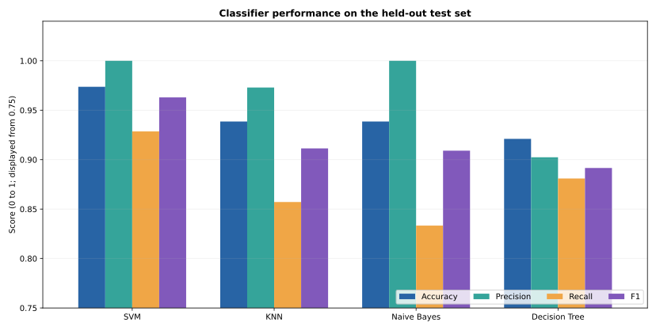
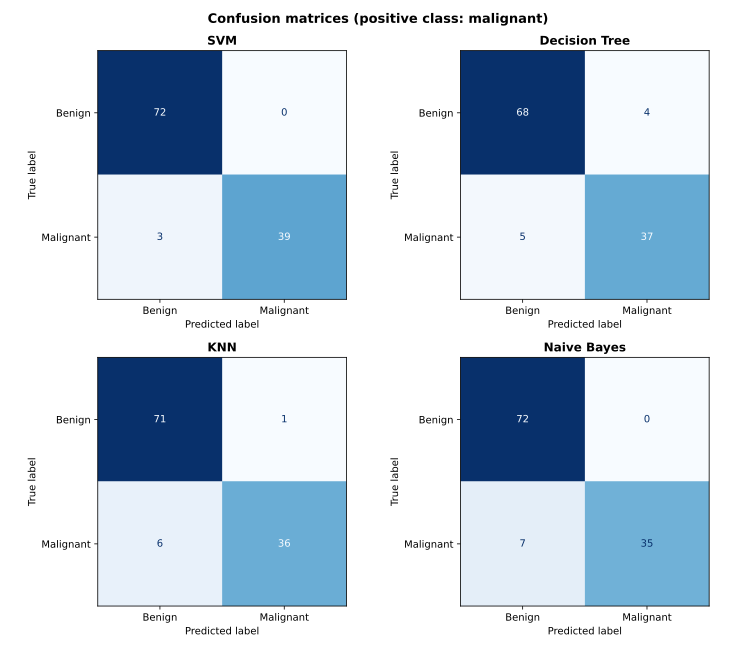
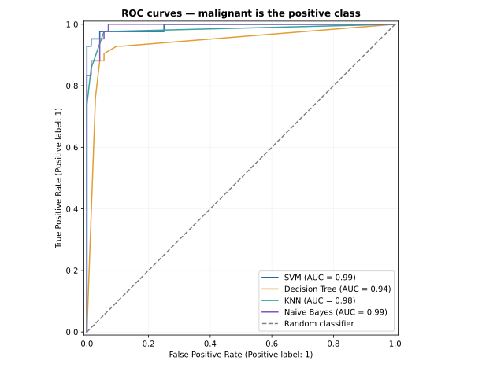

# Classification Models — AIML Practical 04

Implementation and comparison of four supervised classification algorithms on the **Wisconsin Diagnostic Breast Cancer** dataset: Support Vector Machine (SVM), Decision Tree, K-Nearest Neighbors (KNN), and Gaussian Naïve Bayes.

This repository contains the code, an instructional Jupyter notebook, saved experiment outputs, and visual comparisons for MIT Academy of Engineering's TY B.Tech. AIML Practical Assignment 04 (2026–27).

## What this experiment does

The dataset contains **569 observations**, **30 numerical features**, and two labels. For this experiment the target is explicitly mapped to `0 = benign` and `1 = malignant`, so positive-class recall always means **malignant recall**. There are 357 benign and 212 malignant observations.

Every model uses the **same stratified 80/20 train/test split** (`random_state=42`: 455 training, 114 testing). A five-fold stratified cross-validation search on the *training partition only* chooses hyperparameters by positive-class F1-score. Standardization stays inside a `Pipeline` for SVM and KNN to avoid leakage between validation folds.

The held-out test partition is never used for tuning.

## Results

Results below are from a verified run with scikit-learn 1.8.0. The positive class is malignant; values are rounded to four decimals.

| Model | Accuracy | Precision | Recall | F1 | Log loss | ROC-AUC |
|:--|--:|--:|--:|--:|--:|--:|
| **SVM** | **0.9737** | **1.0000** | **0.9286** | **0.9630** | **0.0946** | 0.9927 |
| KNN | 0.9386 | 0.9730 | 0.8571 | 0.9114 | 0.4024 | 0.9825 |
| Gaussian Naïve Bayes | 0.9386 | 1.0000 | 0.8333 | 0.9091 | 0.4086 | **0.9934** |
| Decision Tree | 0.9211 | 0.9024 | 0.8810 | 0.8916 | 1.6452 | 0.9425 |

Five-fold cross-validation on training data:

| Model | Baseline CV F1 | Tuned CV F1 | CV std. dev. |
|:--|--:|--:|--:|
| SVM | 0.9610 | **0.9674** | 0.0114 |
| KNN | 0.9510 | 0.9633 | 0.0250 |
| Naïve Bayes | 0.9185 | 0.9185 | 0.0361 |
| Decision Tree | 0.8962 | 0.9127 | 0.0279 |

The chosen configurations were **SVM:** `C=10, kernel='rbf'`; **KNN:** `n_neighbors=3, weights='uniform'`; **Decision Tree:** `criterion='gini', max_depth=None, min_samples_leaf=3`; and **Gaussian Naïve Bayes:** `var_smoothing=1e-9`.

### Visualizations







SVG previews are tracked in the repository; the script also produces high-resolution PNG versions for reports.

## Interpretation

On this particular test split, SVM had the highest accuracy and F1-score and the lowest log loss. Its confusion matrix was `[[72, 0], [3, 39]]` (rows = true benign/malignant; columns = predicted benign/malignant), meaning **three malignant observations were incorrectly predicted as benign**.

The other models missed five (Decision Tree), six (KNN), and seven (Naïve Bayes) malignant observations. Naïve Bayes had marginally higher ROC-AUC than SVM, illustrating that threshold-independent ranking is different from recall or F1 at a fixed decision threshold.

A trivial majority-class classifier would achieve **63.16% accuracy** while recognizing **zero malignant samples**. This illustrates why accuracy on its own can be misleading.

**Limitations:** A small educational dataset and one test split do not prove general performance. Evaluating more data, independent populations, different thresholds, and probability calibration is needed before considering any real-world use. **This project is not a medical diagnostic tool.**

## Installation & usage

Use **Python 3.11+** and a virtual environment if possible.

```bash
# Clone and enter the repository
git clone https://github.com/QuantumGod007/MDM_AIML_Practical-Assignment-4-Classification-Models.git
cd MDM_AIML_Practical-Assignment-4-Classification-Models

# Recommended: activate your own virtual environment
python -m pip install -r requirements.txt

# Train and evaluate all four classifiers and regenerate charts
python classification_models.py

# Run lightweight checks
python -m unittest discover -s tests -v

# Optional interactive notebook
jupyter lab classification_models.ipynb
```

You do **not** have to download a separate dataset; `load_breast_cancer()` is bundled with scikit-learn. The experiment may take some time because hyperparameters are evaluated with five-fold cross-validation. Results are saved under `results/` and existing generated artifacts are replaced when the script is rerun.

## Repository contents

```text
.
├── classification_models.py          # Complete end-to-end experiment
├── classification_models.ipynb       # Notebook with explanation and reproducible cells
├── requirements.txt                  # Dependencies for reproducibility
├── .gitignore
├── README.md
├── tests/
│   └── test_project.py               # Dataset and pipeline smoke tests
└── results/
    ├── classification_results.csv     # Full-precision metrics, CV and confusion counts
    ├── experiment_summary.json        # Dataset, split and baseline information
    ├── console_output.txt             # Captured run output
    ├── metrics_comparison.svg         # GitHub preview
    ├── confusion_matrices.svg         # GitHub preview
    ├── roc_curves.svg                 # GitHub preview
    └── *.png                          # High-resolution versions (generated by the script)
```

## Dataset and tools

- **Dataset:** [Breast Cancer Wisconsin (Diagnostic)](https://archive.ics.uci.edu/dataset/17/breast+cancer+wisconsin+diagnostic) — UCI Machine Learning Repository; accessed through [`sklearn.datasets.load_breast_cancer`](https://scikit-learn.org/stable/modules/generated/sklearn.datasets.load_breast_cancer.html).
- **Implementation:** Python, NumPy, pandas, Matplotlib, and [scikit-learn](https://scikit-learn.org/).

**Course:** Artificial Intelligence and Machine Learning · TY B.Tech. Software Engineering · Practical Assignment 04.